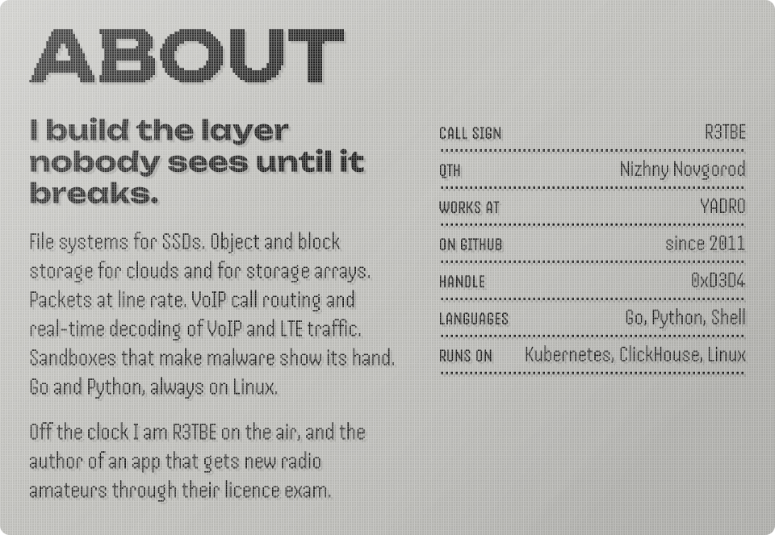
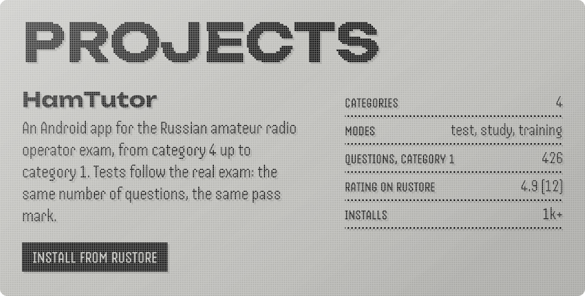
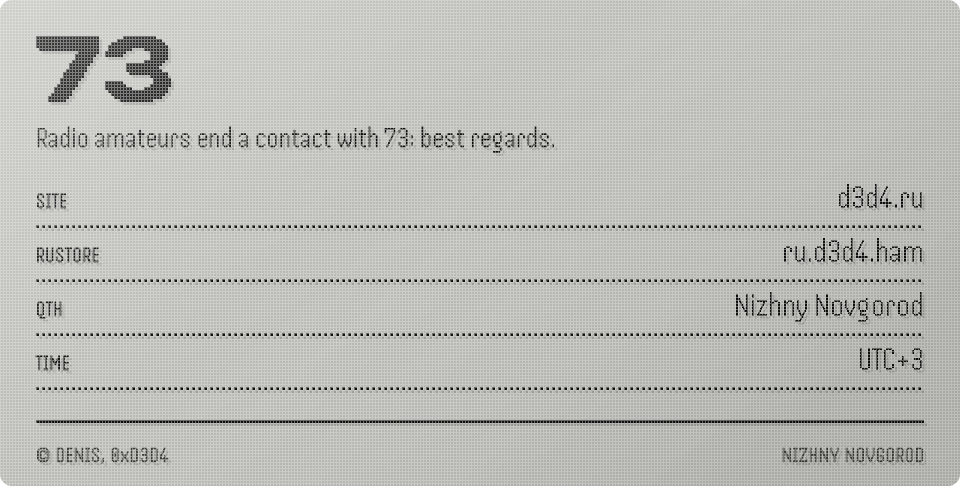

<a href="https://d3d4.ru">d3d4.ru</a> · <a href="https://www.rustore.ru/catalog/app/ru.d3d4.ham">HamTutor on RuStore</a>

<!-- The panels are built by tools/build.py from the fonts and portrait of ehles/ehles.github.io. -->
